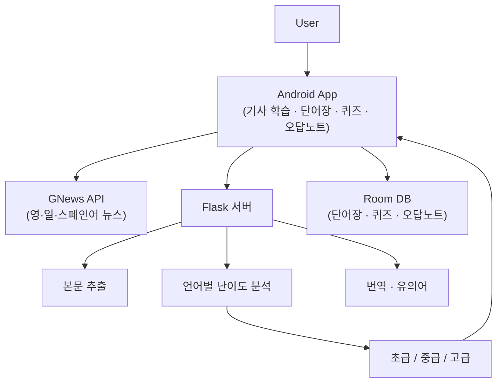

# NewsPeed · 실시간 뉴스 기반 다국어 학습 앱

> 실시간 뉴스(영어·일본어·스페인어)를 학습자 수준에 맞게 난이도 분류하고, 기사 읽기부터 단어 복습까지 하나의 흐름으로 잇는 Android 학습 앱

**2025 캡스톤디자인 1** · 4인 팀 프로젝트 (2025.03 – 06)

`Kotlin` · `Jetpack Compose` · `Room` · `Flask` · `NLP (spaCy · fugashi · Google Cloud NL)`

---

## 개요

기존 외국어 학습 앱은 정해진 예문·교재형 문장 중심이라, 학습자가 실제 사회·경제·문화 이슈에서 쓰이는 표현을 접하기 어렵습니다. NewsPeed는 **매일 갱신되는 뉴스를 학습 콘텐츠로 전환**하고, 기사 본문을 분석해 **초급·중급·고급으로 자동 분류**합니다. 사용자는 자기 수준에 맞는 기사를 읽으며 모르는 단어를 바로 번역·저장하고, 퀴즈와 오답노트로 복습합니다.

`뉴스 수집 → 본문 추출 → 언어별 난이도 분석 → 기사 학습 → 단어 저장 → 퀴즈·오답 복습`

## 시스템 구조

연산과 외부 API 호출이 필요한 작업은 **Flask 서버로 분리**하고, Android 앱은 UI·상태 관리·로컬 저장에 집중하도록 역할을 나눴습니다.



## 핵심 구현

**1. 실시간 뉴스 기반 학습 콘텐츠** — GNews API로 최신 뉴스를 수집하고, 기사 URL을 Flask 서버로 보내 본문을 추출한 뒤 학습 텍스트로 변환합니다. 정적 예문이 아닌 매번 새로운 뉴스가 학습 자료가 됩니다.

**2. 언어별 특성을 반영한 난이도 분석** — 언어마다 난이도에 영향을 주는 요소가 다르다고 판단해, 언어별로 분석 서버를 분리하고 서로 다른 지표로 점수를 계산했습니다.

| 언어 | 난이도 분석 지표 |
| --- | --- |
| 영어 | 전체 단어 수, 평균 단어 길이, 구문 트리 깊이, 평균 의존 거리, 엔터티 수·중요도, 종속절 수 |
| 일본어 | 평균 문장 길이, 한자 비율, 고유어 비율, 동사·보조동사 비율 |
| 스페인어 | 평균 문장 길이, 명사·동사·형용사·접속사 비율 (구조적 복잡도) |

**3. 읽기에서 복습까지 이어지는 학습 루프** — 기사 상세에서 전체·문장·단어 번역, TTS, 유의어 조회, 단어 저장을 제공합니다. 저장 단어(10개 이상)로 4지선다 퀴즈를 생성하고, 틀린 단어는 오답노트로 이어집니다. `word + language_code` 복합 unique index로 중복 저장을 방지하고, 동일 언어·카테고리 재요청 시 10분 캐시로 불필요한 API 호출을 줄였습니다.

## 담당 역할

- **일본어·스페인어 기사 난이도 분류 로직** — 언어별 특성을 고려한 분석 지표로 초급·중급·고급 분류 기준을 구현하고, 앱이 결과를 받아 `My Level / Other Level`로 구분되도록 연동
- **단어장 기반 퀴즈** — 저장 단어 기반 4지선다(정답 1 + 오답 3) 생성, 단어 수에 따른 시작 조건·문항 수(최대 30) 설계
- **오답노트** — 틀린 단어 저장, 최신순·오래된순·알파벳순 정렬 조회, 단어장→퀴즈→오답 복습 학습 루프 완성

> **문제 해결 경험**: 언어별 난이도 기준이 모호하고 AI가 제안한 기준만으로는 신뢰성이 부족해, 언어별 연구 자료를 직접 찾아 지표를 재정의했습니다. 적합한 기준 확보가 어려운 중국어는 지원 범위에서 제외하는 의사결정으로 완성도를 지켰습니다.

## 기술 스택

| 구분 | 기술 |
| --- | --- |
| Language | Kotlin, Python |
| UI | Jetpack Compose, Material3, XML |
| Architecture | ViewModel, StateFlow, Navigation Compose |
| Local DB | Room Database |
| Network | Retrofit, OkHttp, Gson |
| Server | Flask |
| NLP | Google Cloud Natural Language API, spaCy, fugashi |
| Translation / API | Google Cloud Translate, GNews, Datamuse, BabelNet |
| Article Extraction | trafilatura, BeautifulSoup |

## 서버 구성

| 기능 | 파일 |
| --- | --- |
| 본문 추출 / 일본어 토큰화 | `extract_server.py` |
| 영어 난이도 분석 | `nlpServerNew.py` |
| 일본어 난이도 분석 | `japaneseAnalyze.py` |
| 스페인어 난이도 분석 | `spanishAnalyze.py` |
| 번역 | `translate.py` |
| 유의어 조회 | `synonyms_server.py` |

## 실행 방법

**Android** — Android Studio에서 프로젝트를 열고 `app` 모듈 실행. 루트에 `local.properties` 생성:

```properties
sdk.dir=C:\\Path\\To\\Android\\Sdk
GNEWS_API_KEY=your-gnews-api-key
```

**Flask 서버** — 각 서버를 별도 터미널에서 실행:

```bash
cd flask-server
python -m venv venv && venv\Scripts\activate
pip install -r requirements.txt
python -m spacy download en_core_web_sm
python extract_server.py   # 이하 각 분석 서버 실행
```

> 에뮬레이터에서 로컬 서버 접근 시 `10.0.2.2`, 실기기는 개발 PC IP를 사용합니다.

## 보안

`local.properties`, `.env`, Google Cloud 서비스 계정 JSON, 각종 API Key는 커밋하지 않으며 로컬 설정·환경변수로 관리합니다.