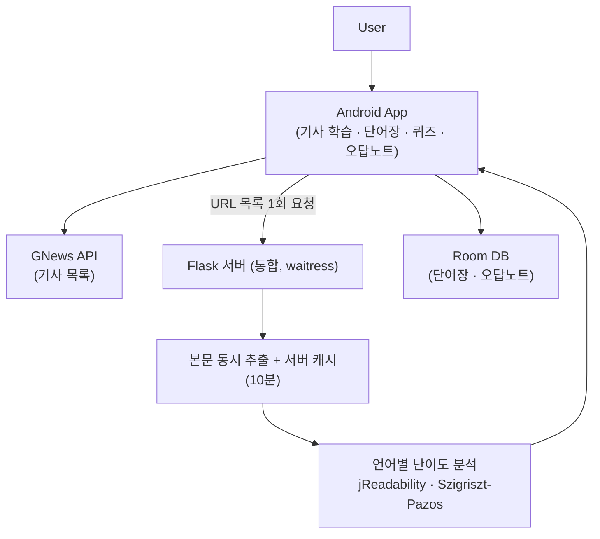

# NewsPeed - 실시간 뉴스 기반 다국어 학습 안드로이드 앱

> 실시간 뉴스(영어·일본어·스페인어)를 난이도별로 분류하고, 기사 읽기부터 단어 복습까지 하나의 흐름으로 잇는 Android 학습 앱

**2025 캡스톤디자인 1** · 4인 팀 프로젝트 (2025.03 – 06) · **2026.10 개인 개선**

`Kotlin` · `Jetpack Compose` · `Room` · `Flask` · `fugashi(UniDic)` · `spaCy`

> **이 저장소에 대해**
> 캡스톤 제출 당시 코드는 [`v1-team-submission`](../../tree/v1-team-submission) 태그에 그대로 남아 있습니다.
> 이후 커밋은 제가 코드를 다시 읽으며 찾은 문제를 고치고, 고친 결과를 수치로 측정한 개인 작업입니다. 아래 [개선 기록](#개선-기록-202610)에 정리했습니다.

---

## 개요

기존 외국어 학습 앱은 정해진 예문·교재형 문장 중심이라, 학습자가 실제 사회·경제·문화 이슈에서 쓰이는 표현을 접하기 어렵습니다. NewsPeed는 **매일 갱신되는 뉴스를 학습 콘텐츠로 전환**하고, 기사 본문을 분석해 **초급·중급·고급으로 자동 분류**합니다. 사용자는 기사를 읽으며 모르는 단어를 저장하고, 퀴즈와 오답노트로 복습합니다.

`뉴스 수집 → 본문 추출 → 언어별 난이도 분석 → 기사 학습 → 단어 저장 → 퀴즈·오답 복습`

## 시스템 구조



연산과 외부 호출은 Flask 서버가, 화면·상태·로컬 저장은 Android 앱이 맡습니다.

## 난이도 분석

| 언어 | 방법 | 3단계 기준 |
| --- | --- | --- |
| 일본어 | **jReadability** (Lee & Hasebe). MeCab(fugashi)+UniDic 단단위로 평균 문장 길이(단어 수)와 한어·화어·동사·조동사 비율(%) | 논문 6단계 구간을 묶어 4.5 이상 초급 / 2.5 이상 중급 / 미만 고급 |
| 스페인어 | **Szigriszt-Pazos** 가독성 + INFLESZ 척도 | 65 이상 초급 / 55 이상 중급 / 미만 고급 |
| 영어 | 구문 트리 깊이·의존 거리·종속절 수 등 6개 지표 가중합 (팀원 구현) | 63 초과 중급 / 70 초과 고급 |

## 개선 기록 (2026.10)

### 1. 난이도 공식을 원 논문 조건대로 다시 구현
제출본의 일본어 공식은 jReadability와 계수가 같았지만, 비율을 %가 아니라 0~1로, 문장 길이를 단어 수가 아니라 **글자 수**로 넣고 있었습니다. 그 결과 점수가 사실상 문장 길이 하나로 정해졌습니다. 스페인어도 품사 비율 항의 기여가 1점 안팎이라 평균 문장 글자 수로 정해졌습니다.

공개 말뭉치로 기존 공식과 개선 공식을 같은 조건에서 비교했습니다 (원문은 저장소에 넣지 않고 [`evaluation/`](flask-server/evaluation)의 스크립트로 내려받습니다).

| 평가 | 지표 | 기존 | 개선 |
| --- | --- | --- | --- |
| 일본어 · SNOW T15 150쌍<br/>(같은 문장의 원문 vs 사람이 고쳐 쓴 쉬운 일본어) | 쉬운 쪽을 더 쉽다고 판단한 비율 | **5.3%** | **66.0%** |
| 스페인어 · Vikidia vs Wikipedia 100쌍<br/>(같은 제목의 어린이용 / 일반 백과) | 쉬운 쪽을 더 쉽다고 판단한 비율 | 77% | **81%** |
| | 어려운 글을 '고급'으로 분류 | 2% | **47%** |
| | 쉬운 글을 '초급'으로 분류 | 30% | **43%** |

- 일본어 기존 공식은 쉬운 일본어를 오히려 **더 어렵다고** 판단했습니다. 쉬운 일본어는 한자를 히라가나로 풀어 쓰면서 글자 수가 늘어나는데, 글자 수로 점수를 매겼기 때문입니다.
- 스페인어는 순서를 매기는 능력(AUC 0.72)은 비슷했고, 기존 공식이 어려운 글의 87%를 '중급'으로 몰던 등급 구분이 나아졌습니다.
- 한계: SNOW는 일상 문장이라 원문·쉬운 문장 모두 '중급'으로 분류됩니다. 등급 정확도는 스페인어 쪽 결과로만 판단할 수 있습니다.

### 2. 서버 6개 → 1개, 기사 목록을 한 번에 분석
제출본은 기능마다 Flask 프로세스(포트 6개)를 따로 띄웠고, 앱은 기사 10개마다 '본문 추출 → 난이도 분석'을 순서대로 요청했습니다(최대 20번 왕복).

- 서버를 하나로 합치고 `POST /articles/analyze`를 추가했습니다. URL 목록을 받아 본문 추출을 스레드 풀로 동시에 처리하고, 결과를 10분 서버 캐시에 둡니다.
- 유료 Google Cloud NL 의존을 없애고 로컬 라이브러리(fugashi·spaCy)로 바꿔, 키 없이 누구나 실행할 수 있습니다.

| 기사 10개 처리 시간 (3회 중앙값, [`benchmarks/`](flask-server/benchmarks)) | 기존 방식 (순차) | 배치 | 캐시 적중 |
| --- | --- | --- | --- |
| 일본어 (NHK) | 10.84초 | **4.18초** | 0.003초 |
| 스페인어 (BBC Mundo) | 10.29초 | **3.12초** | 0.004초 |

서버 쪽 처리 시간만 잰 값이고, 앱↔서버 왕복이 20번에서 1번으로 줄어든 효과는 포함하지 않았습니다.

### 3. 코드를 다시 읽으며 찾은 버그
| 문제 | 수정 |
| --- | --- |
| 제출본 그대로는 **컴파일이 되지 않음** (NavGraph import 오류 6건) | import 정리 |
| 퀴즈 마지막 문제를 풀면 등록되지 않은 경로로 이동해 **앱이 종료됨** | 퀴즈 결과 화면과 경로 추가 |
| 오답노트가 메모리에만 있어 앱을 다시 켜면 사라짐. 모든 오답의 id가 0이라 정렬이 무의미하고 **하나를 지우면 전부 지워짐** | Room 테이블로 저장, 틀린 횟수·시각 기록, id 기준 삭제. DB v1→v2 마이그레이션으로 단어장 보존 |
| 뜻이 같은 단어가 있으면 퀴즈 보기가 중복됨 | 뜻 기준 중복 제거 |
| 한 번 받은 카테고리는 10분이 지나도 다시 받지 않음 | TTL 기준으로만 캐시 판단 |
| My Level / Other Level 탭이 ViewModel을 따로 만들어 탭을 옮길 때마다 GNews를 다시 호출 | 두 탭이 하나의 ViewModel 공유 |
| 일본어·스페인어 단어 저장 버튼이 유의어 창 안에만 있는데, 유의어 조회(BabelNet)가 실패하면 창이 열리지 않아 **단어를 저장할 수 없음** | 유의어 조회가 실패해도 창을 열고 '없음'으로 표시 |
| 퀴즈·오답노트에서 돌아오면 단어장 언어 탭이 영어로 초기화됨 | 탭 상태를 rememberSaveable 로 보존 |
| 사용자 레벨이 세 언어 모두 '초급'으로 고정. 레벨 테스트 코드는 있었지만 화면에 연결되지 않았고, 채점 함수는 항상 1번 문제와 비교함 | 아래 4번 |

### 4. 사용자 레벨을 실제로 반영
제출본은 세 언어 모두 `userLevel = "beginner"`로 고정이라 My Level 탭에는 항상 초급 기사만 나왔습니다. 공식을 바로잡은 뒤 실제 일본 뉴스는 대부분 중급·고급으로 분류되어 My Level 탭이 비게 되었고, 그래서 레벨 연결이 필요했습니다.

- 일본어·스페인어 **어휘 레벨 테스트**(10문항, 정답률 80% 이상 고급·60% 이상 중급)를 화면에 연결했습니다. 기존 채점 함수는 문제 번호가 바뀌지 않아 항상 1번 문제의 정답과 비교하던 버그가 있어 문제별로 채점하도록 고쳤습니다.
- 언어별 레벨을 기기에 저장하고, 뉴스 화면 상단에서 직접 바꿀 수도 있습니다.
- **영어 레벨 테스트 추가**: 제출본에는 영어 단어 목록이 없었습니다. 공개 어휘 목록 [NGSL 1.2](https://www.newgeneralservicelist.com)(핵심 어휘 2,809개와 빈도 순위, CC BY-SA 4.0)에서 기능어와 1~100위를 빼고 Google Cloud Translation으로 한국어 뜻을 붙여 2,575개 목록을 만들었습니다([`flask-server/tools/build_english_vocab.py`](flask-server/tools/build_english_vocab.py)). 무작위 100개를 검토한 결과 명백한 오역 1개·애매 2개였고, 발견한 오역은 직접 보정했습니다.
- 영어는 빈도 순위가 있어서 무작위 대신 **쉬운(101~1,000위)·중간(~2,000위)·어려운(2,001위~) 구간에서 3:4:3으로, 쉬운 것부터** 출제합니다. 정답률이 실력을 반영하도록 하기 위해서입니다.
- 레벨이 바뀌면 이미 받은 기사를 **네트워크 재요청 없이** 다시 나눕니다.
- 에뮬레이터에서 10문항 중 7개를 맞혀 '중급'이 추천되고, 저장 후 My Level에 중급 기사가 표시되며, 앱을 다시 켜도 레벨이 유지되는 것을 확인했습니다.
- 영어 레벨 테스트에서 출제 단어의 빈도 순위가 179·424·983 / 1342·1496·1512·1786 / 2186·2579·2712로 구간별 3·4·3개가 쉬운 순서로 나오는 것을 확인했습니다.

검증: 서버 pytest 9개, 앱 JVM 단위 테스트 6개. 에뮬레이터에서 다음 흐름을 직접 확인했습니다.
- 일본어 기사 목록·난이도 표시, 레벨 테스트(7/10 → 중급) → My Level 반영 → 앱 재시작 후 유지
- 스페인어 기사에서 단어 12개 저장 → 퀴즈 7/10 → 결과 화면 → 오답 3개 저장
- 오답 1개 삭제 시 그것만 삭제, 앱 재시작 후 유지, 같은 단어를 다시 틀리면 '2회'로 갱신·'많이 틀린순' 정렬

### 남은 과제
- 번역은 Google Cloud Translation 키, 유의어는 BabelNet 키가 있을 때만 동작합니다.
- 단어 하나만 따로 번역해서 뜻이 어색한 경우가 있습니다(예: salido → '왼쪽'). 문장 문맥을 함께 보내는 방식이 필요합니다.
- 일본어·스페인어 레벨 테스트 단어 목록은 제출본에 있던 것으로 출처가 기록되어 있지 않고, 빈도 순위가 없어 무작위로 출제합니다.
- DB v1 → v2 마이그레이션은 v1 앱을 설치한 기기에서 업그레이드하는 방식으로는 확인하지 않았습니다.

## 담당 역할 (캡스톤 당시)

- **일본어·스페인어 기사 난이도 분류** — 언어별 연구 자료를 찾아 지표를 정하고 초급·중급·고급 분류 API 구현, 앱이 결과를 받아 `My Level / Other Level`로 나누도록 연동
- **로컬 DB와 캐시** — Room 엔티티·인덱스 설계(`word + language_code` 복합 unique), 뉴스 API 10분 캐시
- **단어장 퀴즈·오답노트** — 저장 단어 기반 4지선다, 단어 수에 따른 문항 수(최대 30), 단어장→퀴즈→오답 복습 흐름

화면 UI와 영어 난이도 분석은 팀원이 구현했습니다.

## 기술 스택

| 구분 | 기술 |
| --- | --- |
| Android | Kotlin, Jetpack Compose, Material3, Navigation Compose, ViewModel·StateFlow, Room, Retrofit·OkHttp·Gson |
| Server | Python, Flask, waitress, trafilatura |
| NLP | fugashi + UniDic(일본어), spaCy(영어·스페인어), textstat |
| 외부 API | GNews(기사), Datamuse(영어 유의어), 선택: Google Translate, BabelNet |

## 실행 방법

**서버**

```bash
cd flask-server
python -m venv .venv && .venv\Scripts\activate
pip install -r requirements.txt
python -m spacy download en_core_web_sm
python -m spacy download es_core_news_sm
python run.py            # http://localhost:5000
```

자세한 엔드포인트와 평가 방법은 [flask-server/README.md](flask-server/README.md)에 있습니다.

**Android** — `local.properties.example`을 복사해 `local.properties`를 만들고 `sdk.dir`, `GNEWS_API_KEY`를 채운 뒤 Android Studio에서 `app` 모듈을 실행합니다. 에뮬레이터는 서버에 `10.0.2.2`로 접속하고, 실기기는 `FLASK_HOST`에 개발 PC IP를 적습니다.

## 데이터 출처

- 영어 레벨 테스트 단어: NGSL 1.2 — Browne, C., Culligan, B., & Phillips, J. ([newgeneralservicelist.com](https://www.newgeneralservicelist.com)), CC BY-SA 4.0. 한국어 뜻을 덧붙인 `app/src/main/assets/vocabulary/english.json`도 같은 라이선스를 따릅니다.
- 난이도 평가 말뭉치: SNOW T15 (CC BY 4.0), Vikidia·Wikipedia (CC BY-SA). 원문은 저장소에 포함하지 않습니다.

## 보안

`local.properties`, `.env`, 서비스 계정 JSON, API 키는 커밋하지 않습니다.
